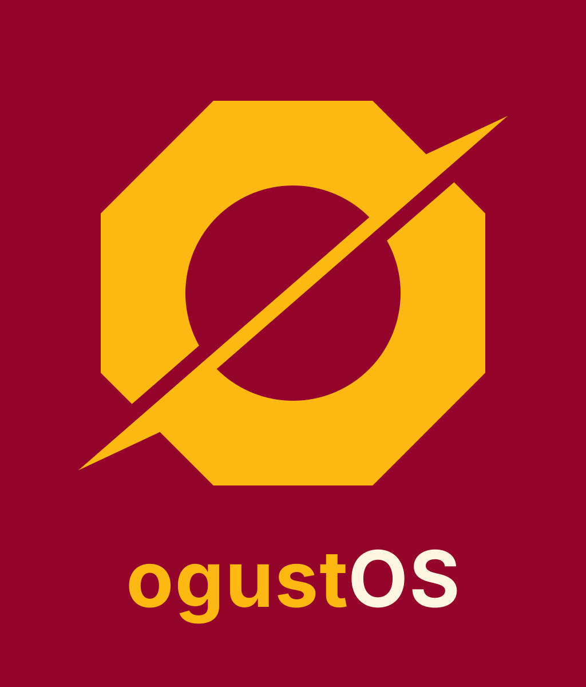

# ogustOS

**ogustOS** is a clean, universal `x86_64` Linux distribution built on **Debian `stable`** with **KDE Plasma Wayland** and the **`ogustOS` APT repository** (`Pin-Priority: 1001`) hosting the four newest upstream hardware components: **Mainline Linux Kernel**, **Kernel Headers**, **`linux-firmware`**, and **`Mesa`**.



---

## Core Architecture

### 1. Three-Tier Repository Hierarchy (`1001 > 900 > 100`)
- **Tier 1 — `ogustOS` Repository (`Pin-Priority: 1001`):** Always wins for the newest upstream **Mainline Kernel (`7.3.x-ogustOS`)**, **Kernel Headers**, **`linux-firmware`**, **`Mesa` (`amd64` + `i386`)**, and `ogustOS` packages (`ogustos-base`, `emerge-pdf`, `meb-sertifika`, `proton-ge-custom`, `libreoffice-fresh`). Tier 2 and Tier 3 can never override Tier 1.
- **Tier 2 — Debian `stable` (`Pin-Priority: 900`):** Provides the rock-solid core OS userland (`glibc`, `systemd`, `kde-plasma-desktop`, `pipewire`, `apt`, `dpkg`). Cannot override Tier 1, and always beats Tier 3.
- **Tier 3 — Pardus `yirmibes` (`Pin-Priority: 100`):** Strictly below Debian `stable` (`900`) so it can never override any package present in Tier 1 or Tier 2; used only for explicit Pardus/institutional packages that do not exist in Debian `stable`.

### 2. The Four Custom Hardware Pillars
1. **Mainline `7.3.x-ogustOS` Kernel & Headers (`scripts/build-kernel.sh`):**
   - Auto-tracks the latest **`mainline`** kernel release from `kernel.org/releases.json`, compiled with **Clang/LLVM** + **ThinLTO** (`CONFIG_LTO_CLANG_THIN=y`) over a portable generic `x86-64` universal driver config.
   - Mainline **EEVDF** scheduler + **`sched_ext`** (`CONFIG_SCHED_CLASS_EXT=y`), `1000 Hz` tick (`CONFIG_HZ_1000=y`), `CONFIG_PREEMPT_DYNAMIC=y` (`CONFIG_PREEMPT=y`), built-in `ext4`, `nvme`, `zram` (`lz4`), `ntsync` (`/dev/ntsync`), `tcp_bbr`, `amd_pstate` (`active`), and `intel_pstate`.
2. **Upstream `linux-firmware` (`scripts/build-firmware.sh`):**
   - Auto-tracks the newest `linux-firmware-YYYYMMDD.tar.gz` snapshot from `cdn.kernel.org/pub/linux/kernel/firmware/` so AMD RDNA 2/3/4, Intel, and Wi-Fi firmware blobs are always up to date.
3. **Upstream `Mesa` (`scripts/build-mesa.sh`):**
   - Auto-tracks the newest release on `archive.mesa3d.org` and compiles both `amd64` and `i386` packages in lockstep (`radv`, `radeonsi`, `anv`, `iris`, `nvk`, and full VA-API video acceleration).
4. **Default Debian `stable` KDE Plasma Wayland Userland:**
   - All userland settings, shells, and desktop configurations remain clean upstream defaults so machine-specific or personal configurations can be layered cleanly per host.

### 3. `ogust` CLI Package & Build Manager

| Command | Description |
| :--- | :--- |
| `ogust up` | Synchronize repositories, full-upgrade, and autoremove orphans |
| `ogust in <pkg>` | Install package(s) (`pkg` or `pkg=version`) |
| `ogust rm <pkg>` | Purge package(s) and unused dependencies |
| `ogust se <query>` | Search available packages across all tiers |
| `ogust versions <pkg>` | Show full version catalogue & repository priorities for `<pkg>` |
| `ogust lock <pkg>` | Pin `<pkg>` at its current version (`apt-mark hold`) |
| `ogust unlock <pkg>` | Unpin `<pkg>` (`apt-mark unhold`) |
| `ogust build [--native] <pkg>` | Compile `<pkg>` from source into a `.deb` (`-O2 -pipe -fuse-ld=mold`) |

---

## Building from Source

```bash
# 1. Build the latest mainline kernel & headers from kernel.org
./scripts/build-kernel.sh

# 2. Package the latest linux-firmware snapshot from kernel.org
./scripts/build-firmware.sh

# 3. Build the latest upstream Mesa stack (amd64 + i386) from archive.mesa3d.org
./scripts/build-mesa.sh

# 4. Build ogustos-base + custom apps and generate the multi-version APT repository
./scripts/build-repo.sh

# 5. Build the hybrid UEFI/GPT Calamares installation ISO (dist/ogustOS-kde-amd64.iso)
sudo ./scripts/build-iso.sh
```
